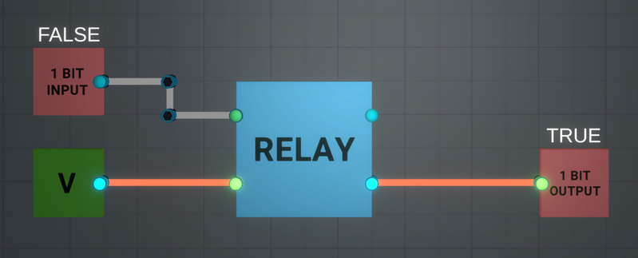
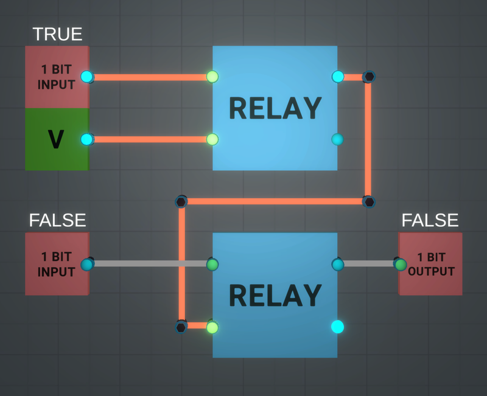
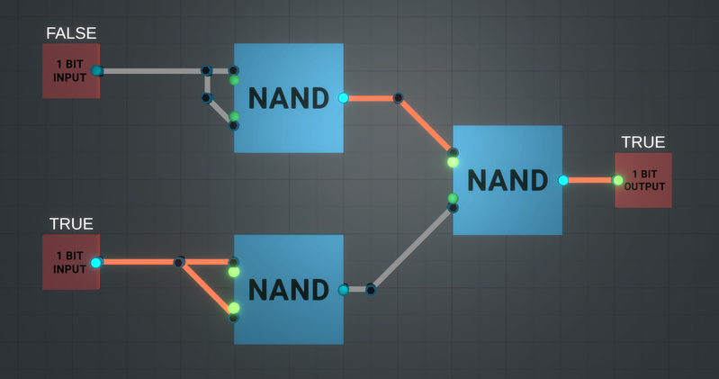
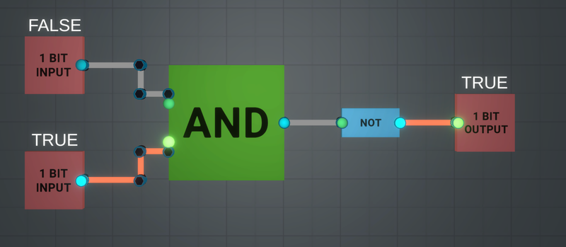
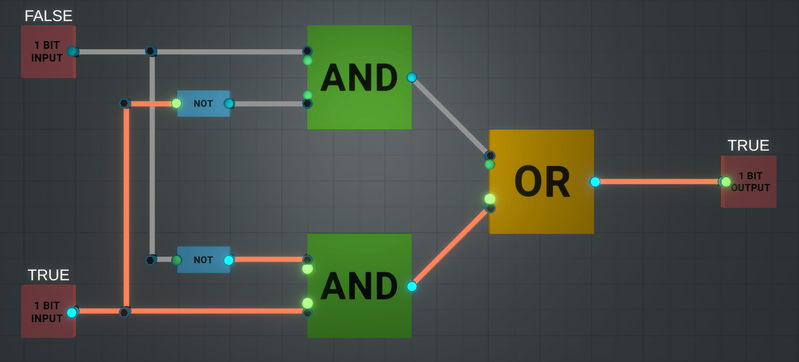
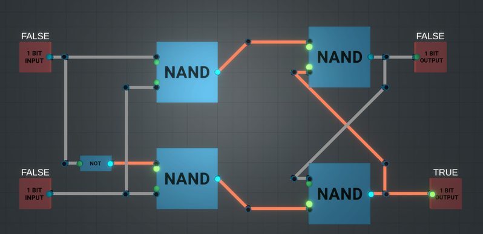

# Voltage Metamorphosis

Welcome to the Voltage Metamorphosis repository! This project is a 3D top-down computer simulator sandbox desktop game developed in Unity Engine. The primary objective of the project is to provide a fun and educational experience for players to learn about basic concepts of computer architecure with the help of electricity and circuit wiring, and gradually design logical gates and more complex modules related to computer architecture.

## Features

- **Educational Gameplay**: Learn about electricity and circuitry in a fun and interactive way.
- **Incremental Design**: Design logical gates and save them for later use in creating integrated circuits and computer architecture modules.
- **Variety of Components**: Access minimal components to build circuits, including primitive gates, half/full adders, latches, registers, RAMs, ALUs, counters, and more.
- **Minimal Valuable Product (MVP)**: Focuses on delivering a basic version of the wiring simulator with essential features to aid students and enthusiasts in learning computer architecture.
- **Collaboration Opportunities**: Engage new developers in collaboration to further enhance the project.

## Schemes created with Voltage Metamorphosis

Every scheme below was wired by hand in the game, starting from a voltage source and relays. Inputs and outputs show their live state (TRUE / FALSE), and a wire glows orange while current flows through it. Once a scheme is saved, it can be reused as a single block inside bigger schemes.

| NOT | AND | OR |
|:---:|:---:|:---:|
|  |  |  |
| A relay that cuts the voltage when the input is on | Two relays in series | Three saved NAND blocks |

| NAND | XOR | D-type latch |
|:---:|:---:|:---:|
|  |  |  |
| A saved AND block followed by NOT | (A AND NOT B) OR (NOT A AND B) | Four NAND blocks that remember one bit |

## Objectives

### Primary Objective
- Design and implement a 3D top-down computer simulator sandbox desktop game.
- Introduce players to basic concepts of electricity and circuit wiring.
- Enable players to incrementally design logical gates and more complex modules.
- Provide a fun and comprehensive learning experience for students and enthusiasts.
- Encourage collaboration among developers to improve the project.

### Secondary Objective
- Deepen my knowledge in computer architecture and a bit the physics.
- Test out new engine-specific plugins for future game development projects.
- Practice debugging, profiling, and implementing programming OOP patterns and standards.
- Develop projects under limitations such as limited computer resources, time constraints, and game design requirements.
- Challenge oneself to implement basic gaming concepts and features of computer making simulator.

## Installation

To install and run Voltage Metamorphosis, follow these steps:

1. Clone the repository to your local machine.
2. Open the project in Unity Engine 2022.3.20f1.
3. Explore the project files and scripts to understand the implementation.
4. Build and run the game to start playing and learning!

## Contribution

Contributions to the Voltage Metamorphosis project are welcome! Whether you're interested in adding new features, fixing bugs, or improving documentation, your contributions are valuable in making the project better.

## License

This project is licensed under the [APACHE LICENSE, VERSION 2.0](LICENSE).

---

Feel free to explore the project and contribute to its development. Happy learning and gaming! 🎮⚡️
